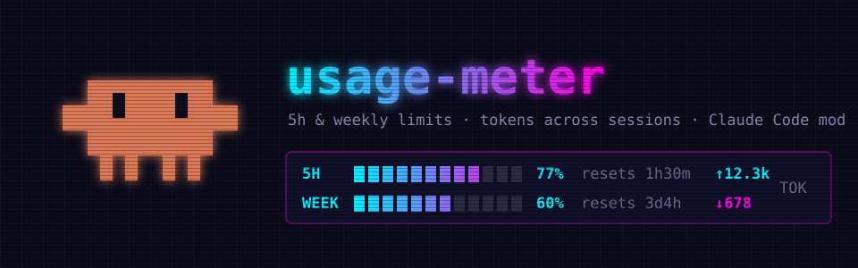
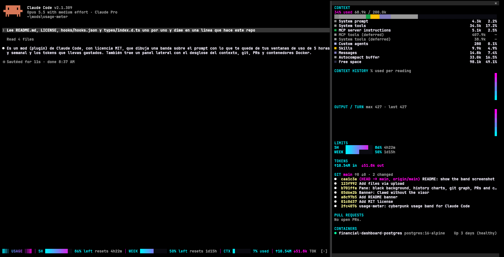

# usage-meter



A Claude Code mod that draws a cyberpunk-style band above the prompt: how much is left of your 5-hour and weekly usage windows (with a cyan-to-magenta gradient bar and the time until each resets), plus the tokens you have spent, accumulated across sessions.


The usage windows appear after the first response of a session, and only on a Claude subscription (Pro/Max).

## The pane



A black side pane (`/usage-meter` opens it; it docks by itself on terminals 144 columns or wider) shows:

- **Context**: the breakdown by category (system prompt, tools, messages, free space…) as a stacked bar and a table of tokens and percentages.
- **Charts**: context % used per reading, and output tokens per turn, as gradient column charts.
- **Limits and tokens**: the 5-hour and weekly windows, and tokens spent across sessions.
- **Git**: current branch, ahead/behind, changed files, and a colored graph of the last 20 commits on all branches.
- **Pull requests**: open PRs of the repository, through the [GitHub CLI](https://cli.github.com) (`gh`).
- **Containers**: every Docker container with its state (running, exited…).

Git, PRs and containers refresh every 30 seconds for the folder the session runs in; any tool that is missing is skipped with a note. To keep some containers out of the pane, set the **Hide containers** option in `/config` to comma-separated parts of their names (for example `prod,client-a`).

## Install

At the prompt of a terminal session:

```
/plugin install usage-meter --marketplace PointerLex/claude-usage-meter
```

Answer `y` to add the marketplace, then pick a scope (user scope is first; press Enter).

From a shell:

```
claude plugin install usage-meter --marketplace PointerLex/claude-usage-meter
```

In the desktop app, where `/plugin` does not run: click + next to the prompt box, then Plugins, Add marketplace with `PointerLex/claude-usage-meter`, then Add plugin.
